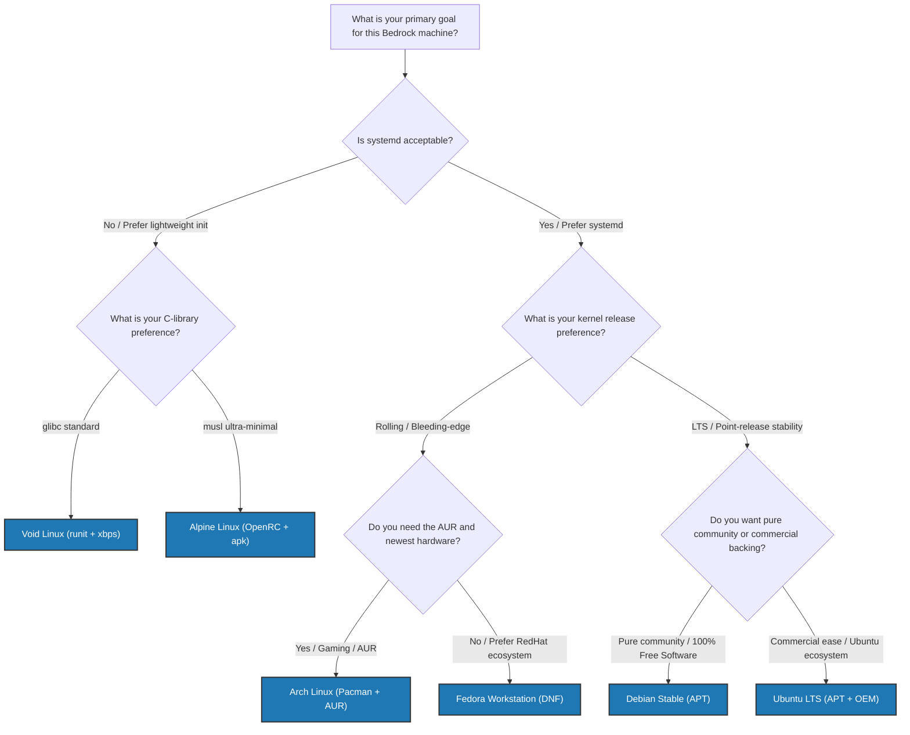

# Base Distro Selection Matrix & Feature Guide

When setting up Bedrock Linux via the **hijack method**, your choice of the **base (host) distribution** is the most crucial architectural decision. While Bedrock allows you to mix and match applications from any stratum post-install, **the host distro permanently provides foundational low-level services**.

---

## 🏗️ What Does the Host Distro Provide?

Even after hijacking, the base distribution you choose remains responsible for:

1. **The Running Linux Kernel & Modules:**  
   Hardware drivers (Wi-Fi, Bluetooth, sound chips, GPU modules like `nvidia` or `amdgpu`) come from the base distro's kernel.
2. **The Hardware Bootloader:**  
   Your EFI partition, GRUB/systemd-boot configuration, and `/boot` files are maintained by the host.
3. **The Default Init System:**  
   While Bedrock allows selecting different inits at boot time, your primary services (display manager, NetworkManager, audio daemons) typically run under the host distro's init.
4. **Display Server & Direct Hardware Acceleration:**  
   Xorg/Wayland and direct DRI/Vulkan GPU interfaces are most stable when aligned with the host kernel and Mesa stack.

---

## 📊 Feature vs. Base Distro Comparison Matrix

| Desired Feature / Focus | Recommended Base Distro | Alternative | Why This Base Distro? |
| :--- | :--- | :--- | :--- |
| **Latest Gaming & Hardware** | **Arch Linux** | Fedora | Newest Linux kernel, cutting-edge Mesa, latest proprietary NVIDIA drivers, AUR gaming packages (`gamescope`, `gamemode`). |
| **Rock-Solid Stability / Server** | **Debian Stable** | Ubuntu LTS | Minimal kernel churn, battle-tested packages, zero unexpected breaking changes across updates. |
| **Out-of-the-Box Hardware / ZFS** | **Ubuntu LTS** | Debian | Extensive OEM certified hardware support, canonical proprietary driver wizard, native ZFS on root support. |
| **Non-Systemd / Ultra-Fast Boot** | **Void Linux** | Alpine | Powered by `runit` init, boots in 2–4 seconds, glibc or musl options, light footprint (~100MB idle RAM). |
| **Embedded / Minimal RAM (<512MB)** | **Alpine Linux** | Void (musl) | Ultra-lightweight `musl-libc` and `OpenRC`, tiny container-friendly footprint (~40MB idle RAM). |
| **Enterprise Dev / SELinux** | **Fedora** | Debian | Modern upstream stack, excellent Wayland/GNOME experience, SELinux security integration. |

---

## 🗺️ Decision Flowchart

Use this visual guide to identify your ideal base distribution:



---

## 📝 Interactive Feature Checklist & Self-Scoring

Answer the questions below to tally which base distribution scores highest for your workflow:

### Question 1: What hardware are you installing on?
* **A.** Brand new PC/laptop with modern GPU (NVIDIA RTX 40xx/50xx, AMD Radeon RX 7000/8000, Intel Core Ultra) *(+3 Arch, +2 Fedora)*
* **B.** Proven desktop/laptop or enterprise server hardware *(+3 Debian, +2 Ubuntu)*
* **C.** Older machine, low-spec laptop (< 4GB RAM), or resource-constrained VM *(+3 Void, +3 Alpine)*

### Question 2: How do you feel about kernel and package updates?
* **A.** I want continuous rolling updates with the newest Linux kernel within days of release *(+3 Arch, +2 Void)*
* **B.** I want a stable, predictable base that rarely modifies core libraries *(+3 Debian, +3 Ubuntu)*
* **C.** I want modern 6-month release cadences with fresh GNOME/KDE *(+3 Fedora)*

### Question 3: Which init system do you prefer?
* **A.** `systemd` (Industry standard, broad service file support) *(+2 Arch, +2 Debian, +2 Ubuntu, +2 Fedora)*
* **B.** `runit` (Blazing fast, simple process supervision, no systemd) *(+4 Void)*
* **C.** `OpenRC` (Traditional runlevel scripts, minimal memory) *(+4 Alpine)*

### Question 4: What is your primary software packaging need?
* **A.** Access to the Arch User Repository (AUR) for obscure or custom packages *(+3 Arch)*
* **B.** Debian/Ubuntu `.deb` ecosystem and official enterprise binary deb packages *(+3 Debian, +3 Ubuntu)*
* **C.** Ultra-fast package installs and clean lightweight packages *(+3 Void, +3 Alpine)*
* **D.** RPM, COPR, and Fedora development tools *(+3 Fedora)*

---

## 🔍 In-Depth Base Distro Profiles

### 1. Arch Linux (The Gamer & Power-User Choice)
* **Default Init:** `systemd`
* **Package Manager:** `pacman`
* **Best Paired Strata:** Debian (for stable server daemons), Void (for runit testing).
* **Pros:** Always has the latest Linux kernel; instant availability of new Mesa drivers and NVIDIA blobs; full AUR access.
* **Cons:** Requires active maintenance; frequent kernel updates require rebooting for new modules.
* **Detailed Guide:** [Arch Linux Hijack Guide](03-hijack-installation.md)

---

### 2. Debian Stable (The Rock-Solid Production Choice)
* **Default Init:** `systemd` (or `sysvinit`)
* **Package Manager:** `apt`
* **Best Paired Strata:** Arch (for bleeding-edge applications), Alpine (for lightweight chroots).
* **Pros:** Unmatched stability; set-it-and-forget-it host; ideal base for servers or reliable development workstations.
* **Cons:** Older kernel may not support very recently released Wi-Fi or GPU chips.
* **Detailed Guide:** [Debian & Ubuntu Hijack Guide](hijack-debian-ubuntu.md)

---

### 3. Ubuntu LTS (The Out-of-the-Box Convenience Choice)
* **Default Init:** `systemd`
* **Package Manager:** `apt`
* **Best Paired Strata:** Arch (for AUR packages), Fedora (for modern toolchains).
* **Pros:** Ubiquitous commercial driver installers; OEM certified kernels; easy installer; ZFS on root support.
* **Cons:** Snapd sandboxing requires specific Bedrock routing considerations.
* **Detailed Guide:** [Debian & Ubuntu Hijack Guide](hijack-debian-ubuntu.md)

---

### 4. Void Linux (The Non-Systemd Speed Champion)
* **Default Init:** `runit`
* **Package Manager:** `xbps`
* **Best Paired Strata:** Arch (for AUR software), Debian (for broad software availability).
* **Pros:** Near-instant boot time; minimal memory footprint; independent rolling release; clean runit init.
* **Cons:** Smaller package repository (easily augmented by fetching Arch or Debian strata in Bedrock).
* **Detailed Guide:** [Void & Alpine Hijack Guide](hijack-void-alpine.md)

---

### 5. Alpine Linux (The Minimalist & Embedded Choice)
* **Default Init:** `OpenRC`
* **Package Manager:** `apk`
* **Best Paired Strata:** Debian (for glibc software), Arch (for complete desktop apps).
* **Pros:** Tiny memory consumption (< 50MB); `musl-libc` security; instant package installs with `apk`.
* **Cons:** Musl libc can break precompiled proprietary binaries without a glibc stratum.
* **Detailed Guide:** [Void & Alpine Hijack Guide](hijack-void-alpine.md)

---

### 6. Fedora (The Modern Workstation & SELinux Choice)
* **Default Init:** `systemd`
* **Package Manager:** `dnf`
* **Best Paired Strata:** Arch (for AUR), Debian (for legacy deb packages).
* **Pros:** Modern GNOME and Wayland experience; cutting-edge toolchains; strong security defaults.
* **Cons:** SELinux requires permissive mode during the initial Bedrock hijack phase.
* **Detailed Guide:** [Fedora Hijack Guide](hijack-fedora.md)

---

## 🚀 Interactive CLI Decision Wizard

To run our automated decision quiz directly in your terminal, use:

```bash
chmod +x scripts/bedrock-wizard.sh
./scripts/bedrock-wizard.sh
```
